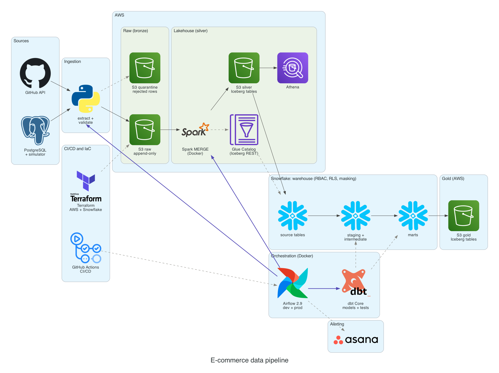
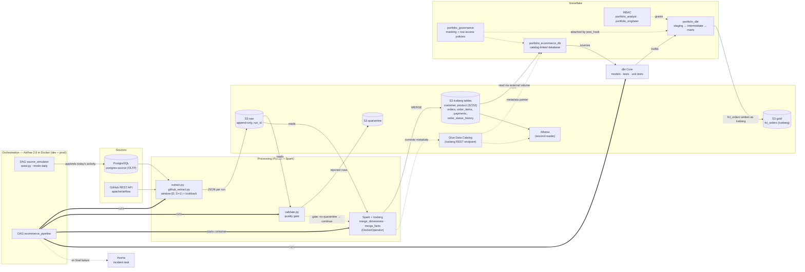
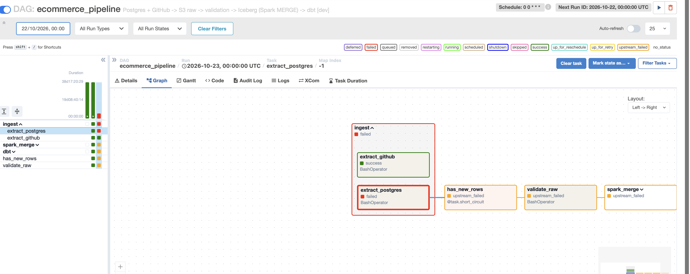
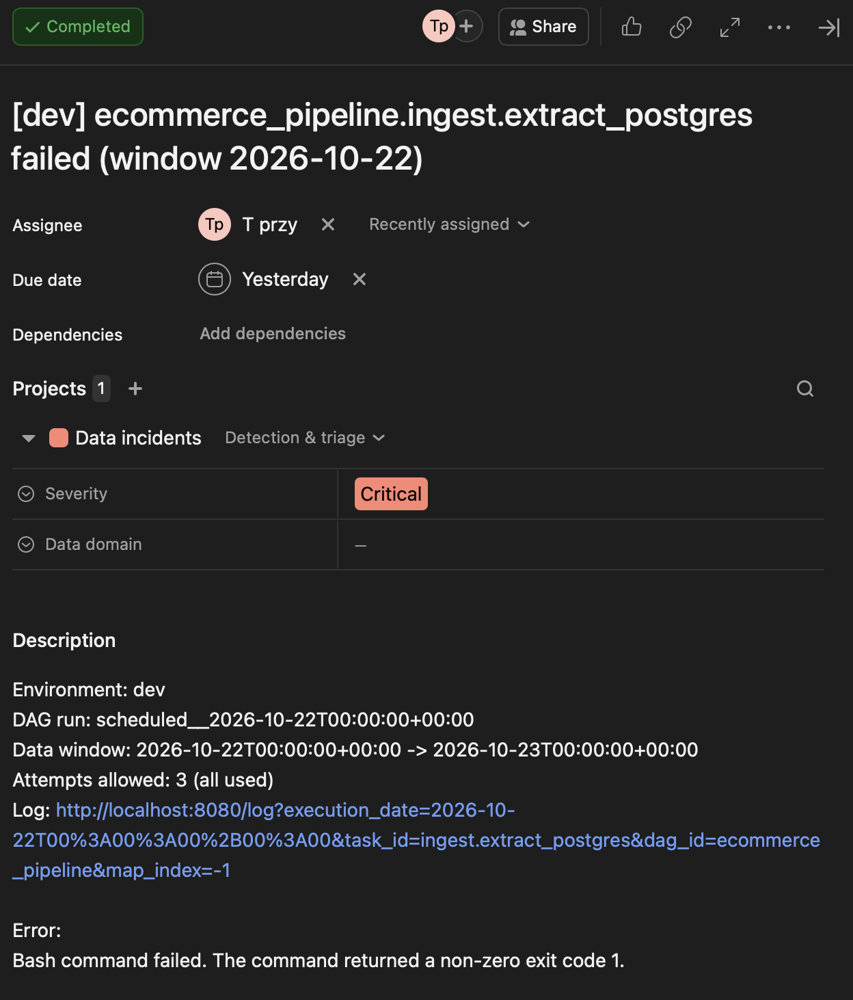
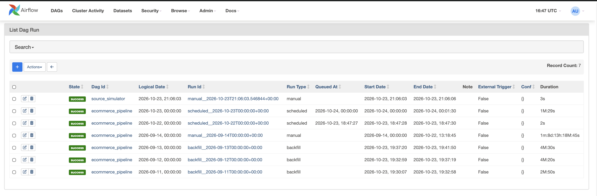
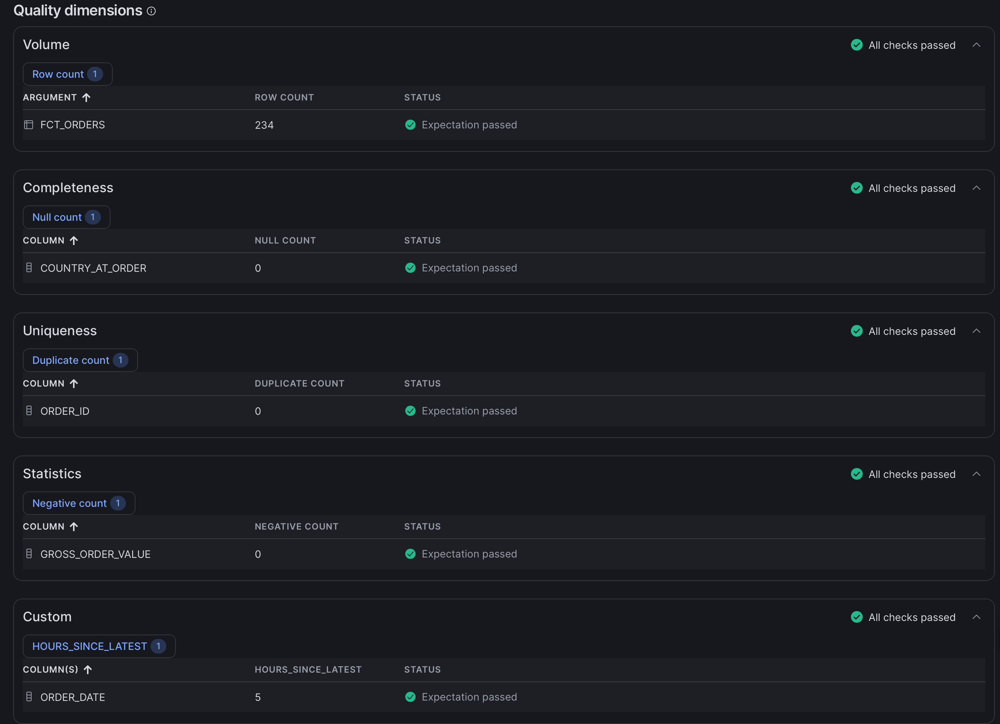
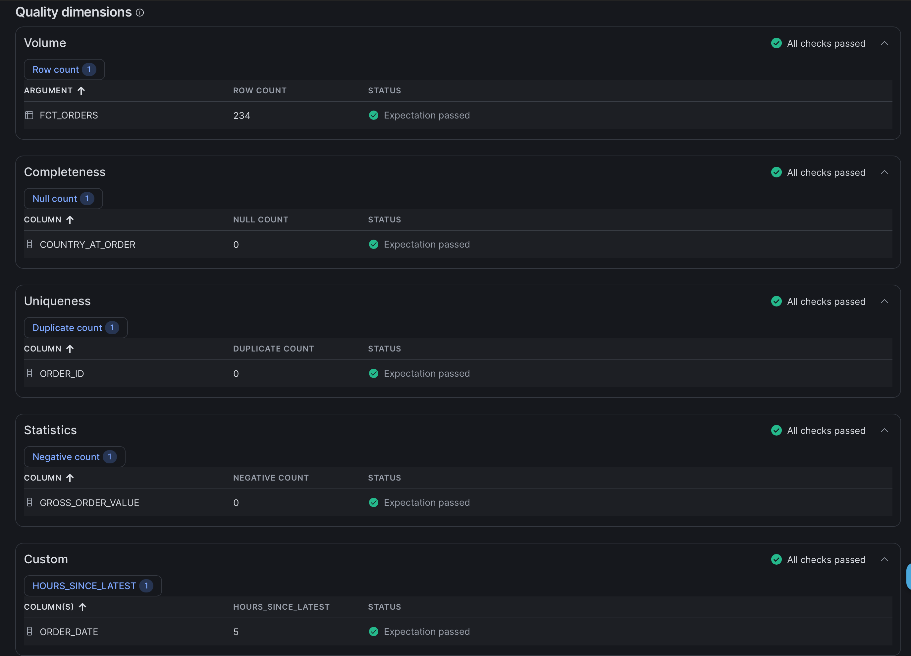
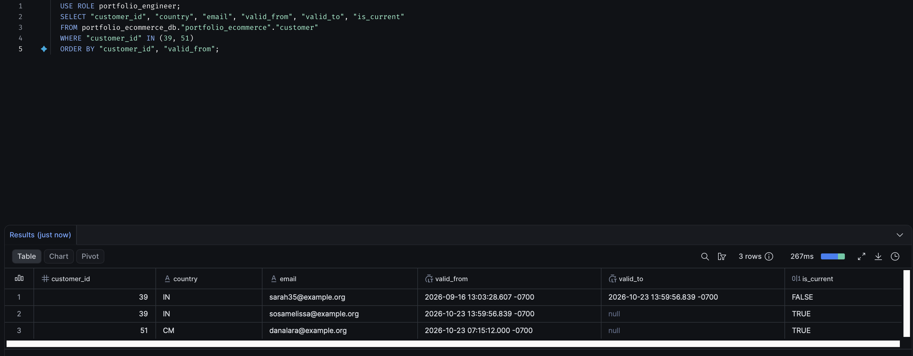
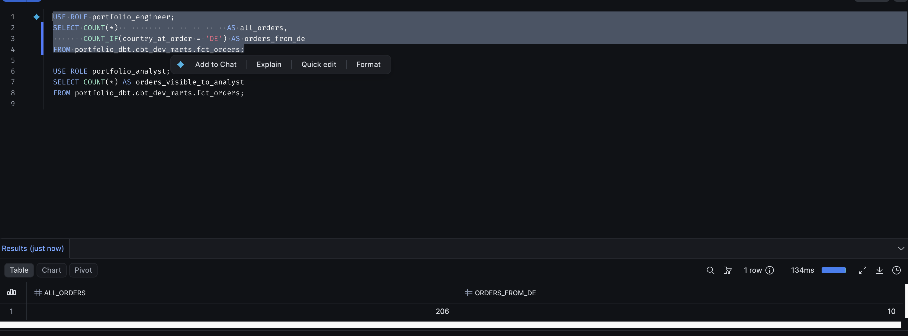
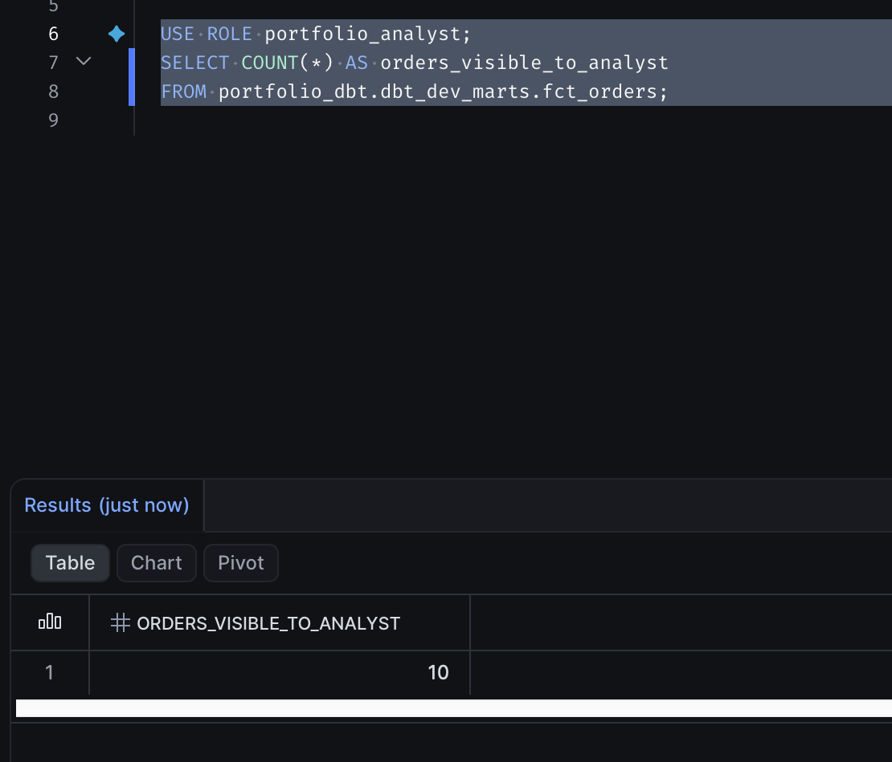

# E-commerce data pipeline — Data Engineering portfolio

A working, end-to-end data pipeline: a transactional PostgreSQL database and the
GitHub API → raw layer in S3 → validation with quarantine → Spark `MERGE` into
Apache Iceberg tables (AWS Glue Data Catalog) → Snowflake reading Iceberg natively
(RBAC, masking, row access policy) → dbt (Kimball models, tests, an Iceberg mart)
→ orchestration in Airflow with retries, alerting and backfill.

This README is built around the questions every production pipeline gets asked —
**what if it runs twice, how would you backfill three months, how do you detect silent
data corruption** — plus the design "why" questions behind the architecture. The
answers are backed by real runs, with numbers and screenshots.

> Snowflake ran on a trial account (until 2026-10-27). Warehouse results are
> documented with screenshots in `docs/images/`.

## Architecture


*Generated from code: `docs/diagrams/architecture.py` (`uv run python docs/diagrams/architecture.py`).
Arrows: dark solid = data flow; purple = what Airflow runs (orchestration — no data passes
through Airflow); grey dashed = metadata and control (catalog pointer, quarantine, dbt's SQL,
alert, deployment, provisioning).*

The detailed dependency map — every arrow labelled with what it carries:



*Solid arrows: data flow (who reads and writes what). Dashed arrows: metadata and control
(catalog pointers, the quality gate, policies, grants, alerts). Thick arrows: what Airflow
runs.*

## Stack

| Layer | Tool | Role in the project |
|---|---|---|
| Sources | PostgreSQL 16, GitHub REST API | OLTP with `updated_at` triggers; external API with pagination |
| Raw | AWS S3 | append-only, every run writes its own files (`run_id`) |
| Raw quality | `validate.py` (Python) | rules on raw files, quarantine, hard gate |
| Processing | PySpark 3.5 + Apache Iceberg, AWS Glue Data Catalog | `MERGE` with deduplication, SCD Type 2 for dimensions |
| Warehouse | Snowflake | catalog-linked database over Iceberg, RBAC, masking, RLS |
| Transformation | dbt 1.12 (dbt-snowflake), `dbt_utils`, `dbt_expectations` | Kimball, point-in-time join, Iceberg mart, data tests and unit tests |
| Orchestration | Airflow 2.9 (Docker, LocalExecutor) | data windows, TaskGroups, retries with backoff, timeouts, alerts, backfill |
| Alerting | Asana API | incident task after the last failed attempt |
| Environment | Docker Compose, uv | dev (`:8080`) and prod (`:8081`) on one host, settings in `config/<env>.yaml` |

Why this stack, which alternatives were rejected (including the Azure/Databricks stack the author
uses at work) and what was deliberately left out: [ADR-001](docs/adr/ADR-001-technology-stack.md).

## 1. What happens if the pipeline runs twice?

Nothing bad — every layer is idempotent:

| Layer | Mechanism |
|---|---|
| Raw (S3) | append-only; each run writes its own files with a `run_id`, a second copy overwrites nothing |
| Iceberg | `MERGE` on the business key with deduplicated input; an existing key is updated, not appended |
| SCD2 (`customer`, `product`) | a new version only when an attribute changes; no change → `nothing to insert` |
| dbt | models are rebuilt deterministically from the layer below |
| Airflow | `max_active_runs=1`, `depends_on_past=True`, windows derived from the data interval, never from "now" |

**Evidence (2026-10-23/24).** Day 2026-10-23 was processed twice — manually at
22:00 UTC and by the scheduled nightly run. Both times 57 rows came from the
source; after the second pass the tables were unchanged (`customer` 53 versions,
`product` 31, `orders` 206, `order_items` 517, `payments` 167,
`order_status_history` 511), dbt `PASS=69`. In one of the runs `extract_github`
even executed three times (a manual `airflow dags test` racing the scheduler) —
without a single duplicate in the tables.

**A retry is also "running twice".** Retries with a growing delay (configured per
environment) are safe precisely because of idempotency. Test: source database
stopped → three attempts (delays of 33 s and 109 s) → failure → one Asana task. The
parallel GitHub branch succeeded; Spark and dbt never started. After fixing the
cause: *Clear* on the same run → success. The quality gate and the short-circuit
decision have `retries=0` — their failures are deterministic.


*The header shows the end of the window (2026-10-23 00:00 UTC); the run processed 2026-10-22.*



## 2. How would you backfill three months?

The mechanics are in place and were tested on three days (2026-09-11..13); what has to
change before a 90-day run is at the end of this section.

```bash
docker compose exec airflow-scheduler airflow dags backfill ecommerce_pipeline -s 2026-09-11 -e 2026-09-13
```

| Day | Rows from source | Validation | Iceberg after `MERGE` | dbt |
|---|---|---|---|---|
| 2026-09-11 | 18 | 0 quarantined | no change (already loaded) | `PASS=69` |
| 2026-09-12 | 21 | 0 quarantined | no change (already loaded) | `PASS=69` |
| 2026-09-13 | 26 | 0 quarantined | no change (already loaded) | `PASS=69` |

Why the tables did not change: these three days had already been loaded by the initial
load (phase 3). The backfill extracted them again, validated them, and `MERGE` found every
row already present with the same values — reprocessing history changes nothing, which is
the idempotency guarantee from question 1 applied to a backfill. New rows actually landing
in the tables: [Real increment through the pipeline](#real-increment-through-the-pipeline)
(57 source rows on 23.10, 6 new orders).

Each run gets its own window `[D, D+1)` (for Postgres with a 10-minute lookback
for late rows — ADR-006); days run in order thanks to `depends_on_past` and
`max_active_runs=1`, about 4.5 minutes per day.



**What has to change before a 90-day backfill** — found in the logs, not in theory:
the `MERGE` steps read the whole raw layer and deduplicate it
(`orders: incoming batch = 200 rows` for 18 extracted rows). The result is correct,
but the cost grows every day — a backfill of N days processes roughly N² rows, and
raw keeps growing because every run appends its files. Planned fix: `MERGE` reads
only the current run's files (paths passed from extraction via XCom, or a filter on
`run_id`).

**Lesson from this phase: never change a `task_id` in a running DAG.** Moving tasks
into a TaskGroup changed their IDs, and with `depends_on_past` the next run waited
forever for an instance that never existed — no failure, therefore no alert.

## 3. How do you detect silent data corruption?

Several layers, because data goes wrong "quietly" in different ways:

| Threat | Detection |
|---|---|
| bad records at the source | `validate.py` on raw files: quarantine and a hard gate before the warehouse |
| broken relationships, unknown statuses, negative amounts | dbt tests: `relationships`, `accepted_values`, `expression_is_true` (with `store_failures`) |
| broken SCD2 history | singular tests: version contiguity (no gaps, no overlaps), point-in-time match, amount reconciliation |
| wrong model logic | dbt unit tests (`int_customer_versions`, `fct_orders`) |
| **pipeline is "green" but no new data arrives** | `dbt_expectations`: freshness of `fct_orders` (≤ 2 days) + source freshness |
| a format change at the source that breaks permissions | `dbt_expectations`: country code `^[A-Z]{2}$` (RLS filters on this value) |
| value anomalies | `dbt_expectations`: `gross_order_value` between 0 and 10,000 |
| technical failure | retries → one Asana incident per failing task after the last attempt (the script's own error from the log, further failures as comments, closed automatically by the next green run) |
| **the whole pipeline stops** (no Airflow run, so no dbt tests either) | Snowflake data metric functions on `fct_orders`, evaluated by Snowflake itself daily at 02:00 UTC: hours since the newest order ≤ 48 (custom DMF), row count > 0, no duplicate `order_id`, no missing country, no negative value |
| personal data nobody listed | `SYSTEM$CLASSIFY` on `customer`: flagged first and last name as identifiers next to the already masked e-mail → masked too |

dbt tests run inside Snowflake: dbt compiles each test into a query that returns
the bad rows (0 rows = pass). Last run: `PASS=21` for `fct_orders`, `PASS=69` for
the whole project.

dbt tests check the data when the pipeline builds it; the data metric functions check
it in the warehouse on their own schedule — the only layer that notices a pipeline that
stopped. They are attached by dbt `post_hook`s (the table is rebuilt every night) and run
as the table owner, which the row access policy does not restrict; owned by a restricted
role they would silently measure only the rows the policy lets through.



*Data quality tab of `fct_orders` after the 02:00 UTC evaluation: 234 rows (all of them — the
owner's view, not the analyst's), no missing country, no duplicate order ID, no negative value,
newest order 5 hours old.*

## Design questions

**Why Iceberg instead of Delta?** An open table format that several engines can
read and write: Spark writes through the Glue catalog, Snowflake reads the same
tables natively and writes its own Iceberg mart. Delta is the stronger choice in a
Databricks-centred stack (Photon, Liquid Clustering); the boundary is blurring
(Delta UniForm generates Iceberg metadata). A Databricks/Delta comparison is planned
as a separate experiment.

**Why an append-only raw layer in S3?** It is the replay and audit insurance: a
backfill never has to delete anything, and "what exactly did the source deliver in
run X" stays answerable. Idempotency is pushed into `MERGE` instead of
purge-and-reload, which is not atomic (ADR-002). Trade-off: retention policies are
needed, and `MERGE` must read only the current run's files (see question 2).

**Why no Bronze layer in Snowflake?** It would add an extra hop into a proprietary
format and lose what Iceberg gives for free (multi-engine access, time travel). In a
pure Snowflake shop with no other engines, native Bronze would be the simpler and
correct choice (ADR-002).

**Why `MERGE`?** Idempotent upsert on the business key, committed atomically as a
new Iceberg snapshot — no window between a `DELETE` and an `INSERT` in which the
table is half-loaded. Input is deduplicated first (latest `updated_at` per key), so
overlapping windows and repeated runs are harmless. SCD2 uses the same mechanism:
close the current version, insert the new one.

**Why the Glue Iceberg REST catalog instead of the direct Glue integration?** It is
Snowflake's current recommendation (the classic Glue integration is being phased
out). A catalog-linked database discovers the existing tables automatically, and
access goes through an external volume with its own IAM role per consumer instead of
vended credentials, which would have added Lake Formation as a second access model
(ADR-004).

**SCD2 in Spark, not with dbt snapshots — why?** The original plan used dbt
snapshots; the implementation keeps history in the Iceberg tables themselves. Every
engine that reads Iceberg sees the same history, and Snowflake does not keep a
second, duplicated copy of it. dbt reads the already-historized tables and builds
point-in-time joins on top (`int_customer_versions`). Trade-off: more PySpark code
than a declarative dbt snapshot, and the version timestamp comes from `updated_at`
(write time at the source, set by a database trigger), not from a business event
time.

**What would you remove if this were a €5M/year production system?**
*Author's working answer — trade-offs, not dogma:*
- self-hosted Airflow with two deployments on one host → a managed Airflow
  (MWAA / Astronomer / Composer), separate accounts per environment;
- custom incremental extraction from Postgres → log-based CDC (e.g. Debezium or a
  managed connector) to capture deletes and take load off the source;
- custom `validate.py` → a standard tool (Great Expectations / Soda) or data
  contracts, keeping the gate itself;
- Spark, if volumes stay this small → dbt incremental models on Snowflake-managed
  Iceberg would do the job with fewer moving parts; Spark stays only where volume or a
  real multi-engine requirement justifies it;
- Asana as the alert target → an on-call tool (PagerDuty / Opsgenie) plus ticketing;
- the source simulator, obviously.

**How are time zones handled?** Every timestamp is a point in time: `TIMESTAMPTZ` in
Postgres, `timestamptz` in the Iceberg silver tables; extraction windows and Airflow data
intervals are in UTC; dbt staging converts every timestamp explicitly with
`CONVERT_TIMEZONE('UTC', …)::TIMESTAMP_NTZ`, so the marts are in UTC. What is not stored
is the local time of the event: 22:52 UTC is already the next day for a customer in
Poland. Reports by the customer's day or a model predicting when people buy would need
the order's time zone recorded at the source (`order_timezone`) — the customer's country
is not enough (multi-zone countries, travel).

## Real increment through the pipeline

The source simulator (`scripts/seed.py --mode daily`, a separate DAG
`source_simulator` running once a day before the pipeline) appends one day of
activity: new customers, attribute changes, a price change, orders and status
transitions. It never modifies history and is idempotent within a day. The first
such day (2026-10-23) went through the whole pipeline:

| Table (Iceberg) | Before | After | Where the difference comes from |
|---|---|---|---|
| customer (all versions) | 51 | 53 | a new customer + a new SCD2 version (email change) |
| product (all versions) | 30 | 31 | a new SCD2 version (price change) |
| orders | 200 | 206 | 6 new orders (8 status changes update existing rows) |
| order_items | 502 | 517 | 15 line items |
| payments | 160 | 167 | 7 payments |
| order_status_history | 493 | 511 | 18 entries |

Both SCD2 paths in Snowflake: customer 39 changed their email (the old version is
closed at exactly the moment the new one opens), customer 51 is a new customer with
a first version.


*Times shown in the Snowflake session time zone (-0700); 13:59:56 -0700 = 20:59:56 UTC.*

## Governance: RBAC, masking, RLS

The same `fct_orders` table, two roles. The engineer sees all 206 orders (10 of them
from DE); the analyst sees only those 10:

| Engineer | Analyst |
|---|---|
|  |  |

On `fct_orders`, `country_rls` (on the country at order time) and a mask on the
customer's current country are attached by a dbt `post_hook` on every rebuild of the
mart, before grants are applied — the analyst never gets a copy of the table without
its policies. On the silver `customer` table, masks on the e-mail and on the first and
last name (the names were flagged by Snowflake's sensitive data classification) are
attached by the scripts in `snowflake/`.

## Running it locally

Requirements: Docker, uv, an AWS account (S3, Glue), a Snowflake account (dbt
authenticates with a private key), a GitHub token, optionally an Asana token.

1. Copy `.env.example` to `.env` in the repository root and fill in the values
   (`.env` is git-ignored).
2. Start the environment:

   ```bash
   uv sync                                     # Python, dbt and libraries locally
   docker compose up -d --build                # postgres-source (schema from sql/ddl.sql), Spark, Airflow dev: http://localhost:8080
   docker compose --profile prod up -d         # optional Airflow prod: http://127.0.0.1:8081
   uv run python scripts/seed.py               # historical data — once, on an empty database
   cd dbt_portfolio && uv run dbt deps && cd ..
   ```

3. In the Airflow UI, enable the `ecommerce_pipeline` and `source_simulator` DAGs.

Snowflake objects are created by the scripts in `snowflake/`, starting with
`00_account_setup.sql` (run order in its header). AWS objects (bucket, IAM roles,
Glue) are created manually for now; Terraform is planned.

## Repository layout

```
dags/            Airflow DAGs (pipeline, simulator) + alerting/ (Asana callback)
scripts/         extraction, validation, MERGE (Spark), seed and source simulator
config/          per-environment settings: schedule, retries, timeouts
dbt_portfolio/   dbt project: staging, intermediate, marts, tests
airflow-docker/  Airflow image: providers, dbt in a separate venv, faker
spark-docker/    Spark + Iceberg image
sql/             source database DDL (with updated_at triggers)
snowflake/       scripts for Snowflake objects managed outside dbt
docs/images/     screenshots from real runs + the generated architecture picture
docs/diagrams/   architecture picture as code (the `diagrams` library)
docs/adr/        architecture decision records (ADRs) + index
```

## Architecture decisions

All ADRs live in [`docs/adr/`](docs/adr/) (index with status per decision).

- **ADR-001** — technology stack: AWS + Apache Iceberg + Snowflake + dbt + Airflow, alternatives and what was left out
- **ADR-002** — raw layer: append-only S3 + `MERGE` into Iceberg instead of a native Bronze layer in Snowflake (with a post-implementation update)
- **ADR-003** — AI-assisted engineering workflow (Claude Code, Codex, hooks, failure log in `ai/failure-log/`)
- **ADR-004** — Snowflake ↔ Iceberg catalog integration (REST + external volume credentials)
- **ADR-005** — layer naming: `dim_`/`fct_` reserved for marts
- **ADR-006** — extraction window: Airflow data interval with a lookback instead of watermark state

## Known limitations and next steps

- `MERGE` reads the whole raw layer instead of the current run's files — to fix before a large backfill.
- Spark steps start a container, JVM and session each (fixed overhead of tens of seconds per step); a long-running Spark Connect server is the planned improvement, after the `MERGE` fix.
- No `dagrun_timeout` — a stuck run is caught only by the freshness checks (dbt test, daily DMF).
- Marts keep timestamps as `TIMESTAMP_NTZ` in UTC ("every NTZ is UTC" is a convention, not the type); the local time of an order is not stored.
- Airflow runs locally (only while the machine is awake); every Airflow service builds its own identical image.
- Next: CI/CD (GitHub Actions: lint, DAG import test, `dbt deps`, slim CI for dbt), Terraform for AWS and Snowflake, observability.

## How it was built

Step by step, with decisions recorded as they were made: the ADRs document decisions
together with the rejected alternatives, and every claim in this README comes with
evidence from real runs (screenshots, logs, row counts). The
project was built with AI assistants following the workflow in ADR-003 — code and
decisions reviewed, AI mistakes recorded in `ai/failure-log/`.
